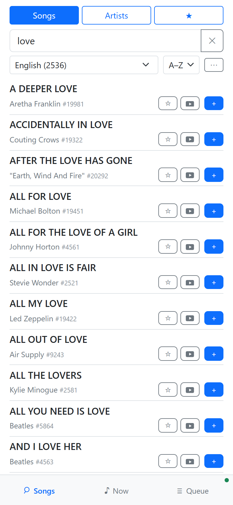
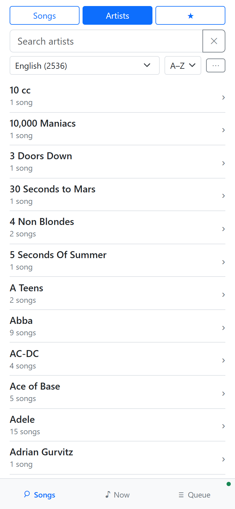
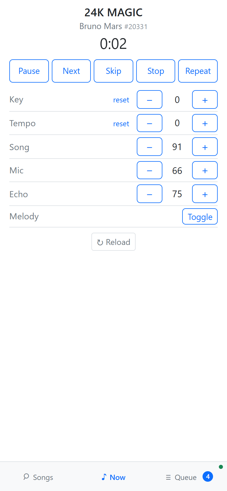
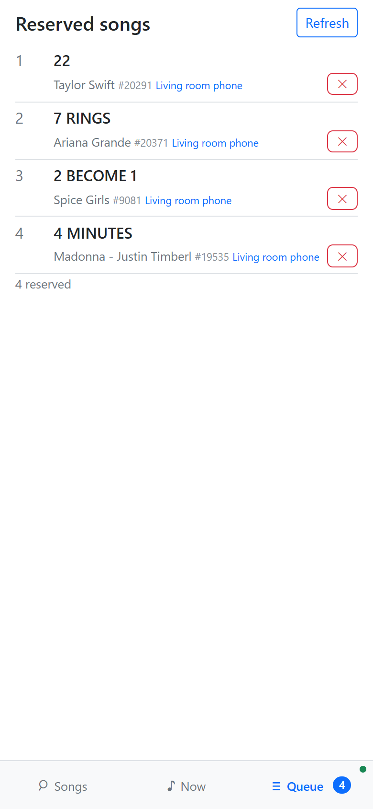
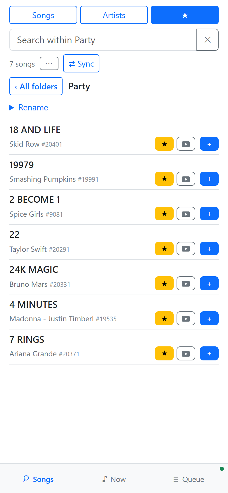
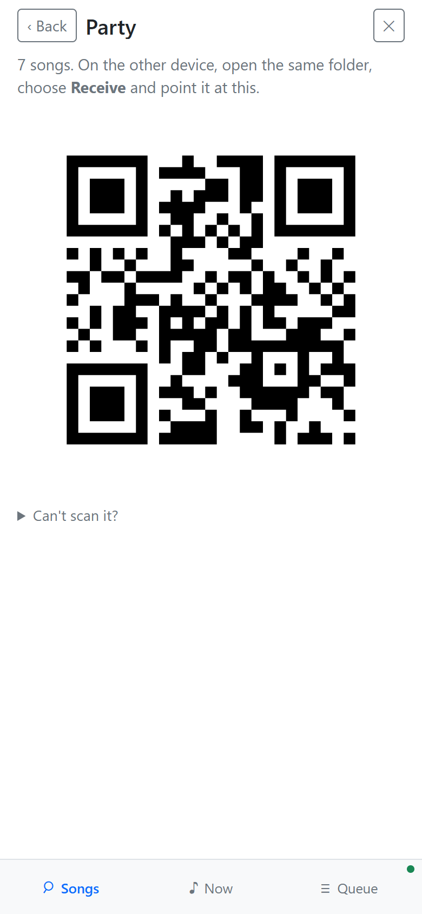

# CK Karaoke

CK Karaoke turns your phone or computer into a remote control for your karaoke
unit. It works with the Videoke VSK family and with units sold under the
CooKara and RafKara names.

With it you can:

- browse and search the unit's song list by title, number or artist;
- add songs to the unit's queue, and see and edit the queue;
- control playback, key, tempo and the song, microphone and echo volumes;
- keep favorites in folders, and share a folder with another phone by QR code.

  
  
  
  

## Download

Get the latest version from the
[releases page](https://github.com/rrgmc/ck-karaoke/releases/latest).

| Platform | File | Notes |
|---|---|---|
| Android 8 or later | `ck-karaoke-<version>-android.apk` | Allow installing apps from your browser or file manager when Android asks. |
| Windows 10 or 11 | `ck-karaoke-<version>-windows-amd64-setup.exe` | If SmartScreen warns you, choose **More info**, then **Run anyway**. |
| macOS 10.13 or later | `ck-karaoke-<version>-macos-universal.dmg` | Drag the app to Applications. Open it the first time with right-click, **Open**. |
| iPhone and iPad, iOS 15 or later | `ck-karaoke-<version>-ios-unsigned.ipa` | You must sign it before iOS installs it; see [Installing the release IPA](ports/ios/README.md#installing-the-release-ipa). |

The Windows and macOS apps are not signed by Microsoft or Apple, so the system
warns you the first time you open them. The `SHA256SUMS.txt` file on the releases page lets you check
that a download is intact.

There is no download for Linux yet. It can be built from source; see
[docs/BUILDING.md](docs/BUILDING.md).

## Getting started

1. Turn on the karaoke unit and connect it to your Wi-Fi network.
2. Connect your phone or computer to the **same** network.
3. Open CK Karaoke. It finds the unit by itself.
4. The first time, the app downloads the unit's song list. This takes a few
   seconds and happens only once.

On an iPhone, iPad or Mac, allow access to the local network when the system
asks. Without it the app cannot find the unit.

The dot at the bottom right is green while the app is connected to the unit,
and red when it is not.

## Using the app

The app has three tabs at the bottom: **Songs**, **Now** and **Queue**.

### Songs

The **Songs** tab lists every song on the unit.

- Type a title or a song number in the search box.
- Choose the language of the songs with the list under the search box, and the
  sort order with **A–Z**.
- Tap **Artists** to list artists instead. Tap an artist to see their songs.
- Tap **+** on a song to add it to the end of the unit's queue.
- Tap the video button to look the song up on YouTube.
- Tap **⋯** to also show **Play next** and **Play now** on each song. They are
  hidden by default, so that nobody pushes a song ahead of the others by
  mistake.

### Now

The **Now** tab shows the song that is playing and controls the unit:

- **Pause**, **Next**, **Skip**, **Stop** and **Repeat**;
- **Key** and **Tempo**, with **reset** to go back to the original;
- the **Song**, **Mic** and **Echo** volumes;
- **Melody**, which turns the guide melody on or off.

### Queue

The **Queue** tab shows the songs waiting to play. Tap **✕** to remove a song.

### Favorites

Tap **☆** on a song to put it in a favorites folder. Tap **★** at the top of the
**Songs** tab to see your folders. Use **+ Folder** to make a new one.

Favorites are kept on each phone or computer, not on the unit.

  
  

To copy a folder to another phone:

1. On the phone that has the songs, open the folder, tap **Sync** and choose
   **Send**. It shows a QR code.
2. On the other phone, open the folder that should receive the songs, or make
   a new one. Tap **Sync**, choose **Receive** and point the camera at the code.

The receiving phone adds the songs it does not have yet. Neither phone ever
removes a song. To make both folders match, repeat the steps in the other
direction.

To keep a copy of every folder, tap **Backup** in the folder list. A backup is
an XML file that you can save and later import on any phone or computer.

## Troubleshooting

**The app does not find the unit.** Check that the unit and your phone or
computer are on the same Wi-Fi network. Some routers keep devices apart on a
guest network. On a Mac, check that CK Karaoke has local network access in
**System Settings**, **Privacy & Security**, **Local Network**. On an iPhone or
iPad, check **Settings**, **Privacy & Security**, **Local Network**.

**The app disconnects after a while on Android.** When the app stays in the
background for ten minutes, it closes the connection to the unit. Open the app
again to reconnect.

**I reinstalled the app and my favorites are gone.** Uninstalling the app
deletes its favorites. Make a backup before you uninstall.

## For developers

- [docs/BUILDING.md](docs/BUILDING.md): repository layout, the command-line
  debug server, building the apps, tests and releases.
- [docs/LIBRARY.md](docs/LIBRARY.md): using the Go packages in your own program.
- [docs/PROTOCOL.md](docs/PROTOCOL.md): the device protocol.
- [docs/ARCHITECTURE.md](docs/ARCHITECTURE.md): how the server and the apps fit
  together.
